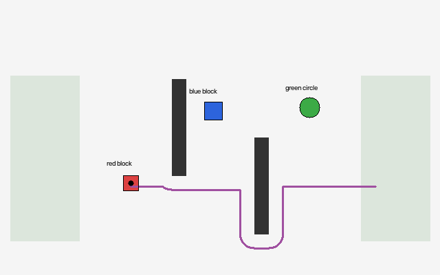

# Vision-Based, Language-Guided Object Manipulation

A small Python robotics assignment: instruction → image perception → grasp feasibility → collision-aware carrying route → execution → image-based verification.

## Foundation-model extension

Optional **text + scene** and **image + scene** API modes now complement the offline rule baseline. See [FOUNDATION_MODELS.md](FOUNDATION_MODELS.md) for setup and evaluation.

**Status:** 23 local tests pass, including mocked API integration tests. Real API evaluation is pending credentials; no live model accuracy is claimed. The 12-case rule baseline scores 9/12 expected outcomes.

## Simulator preview



Program-generated simulator output showing detected objects and the planned route around obstacles to the right tray.

## Start on macOS / Linux
Requires Python 3.12 (tested), internet for first dependency installation, and a browser.

```bash
python3 -m venv .venv
source .venv/bin/activate
python -m pip install -r requirements.txt
python server.py
```
Open **http://127.0.0.1:8765**. Stop with Ctrl+C. On Windows activate with `.venv\Scripts\activate`.

Try `Move the red object to the left tray`. Change scenario to test ambiguity, oversize rejection, or a blocked route. Enable **Simulate a failed grasp** to demonstrate independent placement verification. Change the seed for new shapes, dimensions, and positions. Each run starts from its seed; it is an independent experiment, not a persistent multi-command world.

## Reproduce checks and results
```bash
python -m unittest -v
python evaluate.py
```
`evidence/experiments.csv` contains individual trials. `summary.json` records measured results and versions. The four PNGs are genuine program-generated camera/perception outputs, not photographs or browser screenshots. Session CSV is available in the interface.

## Requirement mapping
| Requirement | Implementation |
|---|---|
| Python | Core pipeline, server, tests and evaluation |
| OpenCV vision | HSV segmentation, contours, moments, bounding boxes, polygon classification |
| Language | Constrained parser extracts colour, size, shape, destination and permitted action |
| A* planning | Four-connected pixel search; obstacle dilation by conservative object radius plus margin |
| Manipulation reasoning | Perceived centroid as grasp point, horizontal opening limit, tray fit and clearance |
| Evaluation | Ground-truth perception/selection scoring, expected outcomes, planning time and path length |
| Safety checks | Ambiguity, unknown instructions, oversize, unreachable placement and invalid destinations |
| Verification | Detect again after execution; require departure from source and increased matching-object count in tray |

## Source guide
- `core.py`: scene generator, renderer, image-only perception, language parser, planner, executor, verifier.
- `server.py`: loopback HTTP interface. Rules need no key; optional API modes use server-side credentials.
- `index.html`: input, camera views, detections, session CSV.
- `test_core.py`: functional and safety checks.
- `evaluate.py`: deterministic held-out evaluation seeds 100–119; development seeds are 0–19.

## Information boundary
`detect(image)` and `plan(image, command)` never receive object metadata. `verify(before, after, chosen, tray)` uses pixels plus the selected visual description. Only renderer, executor, and evaluator access world truth. Known tray coordinates, camera resolution, colour thresholds, gripper limit and workspace boundaries are calibrated constants.

## Assumptions and limits
The offline baseline uses symbolic AI and classical computer vision. Optional API modes connect a pretrained model for instruction interpretation; no model is trained or fine-tuned here. The detector is designed for isolated rigid blocks and circles in clean synthetic images. New seeds give unseen arrangements/size-shape combinations within this constrained generator; they do not prove real-world generalisation. Colour/shape vocabulary stays fixed.

The model is 2D. It does not simulate robot joints, inverse kinematics, forces, friction, occlusion, rotation or grasp stability. Approach to the grasp point is assumed to occur overhead; A* checks the carried-object transfer. The payload uses a conservative circular envelope (half bounding-box diagonal plus margin). There is no claim of real physical handling. The executor models perfect movement unless failure injection is enabled.

Pipeline planning time includes parsing, detection, selection, mask construction and A*, excludes execution and UI rendering. Rejected tasks do not have planning times recorded. Tests of valid task success must be reported separately from correct rejection. Verification is independent of the executor's success flag but shares the same vision algorithm, so correlated perception errors remain possible.

## Relationship to the research topic
Demonstrates the modular reasoning chain behind instruction-guided manipulation. It is an introductory prototype, not a reproduction of a research system or evidence of arbitrary unfamiliar-object grasping.

